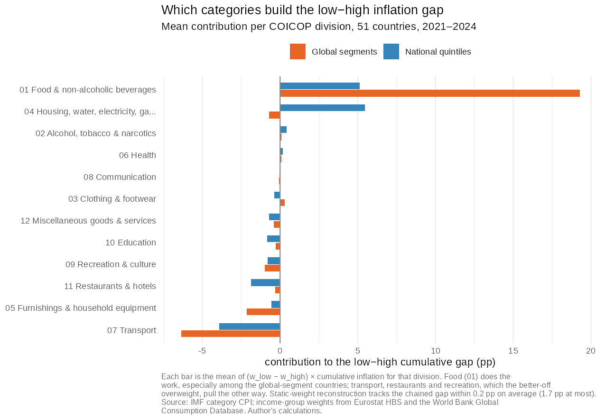

# Replication: A Lower Bound on Inflation Inequality

Code and data to reproduce the tables and figures in *A Lower Bound on Inflation
Inequality: Cross-Country Evidence From Developed and Developing Economies*
(Aghasi Tavadyan).

[](https://doi.org/10.5281/zenodo.21510423)

The paper measures the between-category basket channel of inflation inequality:
income groups face different inflation because their consumption baskets differ
(low-income baskets are food-heavy, high-income baskets carry more services). It
applies per-country income-group expenditure weights to each country's category
price paths and reports the cumulative low/mid/high inflation gap over 2021-01 to
2024-12, for the 51 countries whose category indices reconcile to the official
all-items CPI.

The article itself is not included here (it is published closed-access). This
repository is the replication material referenced in the paper's data
availability statement.



*Figure 4: the low−high inflation gap decomposed by COICOP division and income tier. Rebuild it with `Rscript R/make_decomposition_figure.R`.*

## Requirements

- R (>= 4.1), with `tidyverse`, `jsonlite`, `here`, `ggrepel`, `countrycode`.
  Run `Rscript install.R` to get them. `sf`, `rnaturalearth`, `rnaturalearthdata`
  are optional and only feed an unused coverage map, which skips itself if they
  are absent.
- Python 3 with `openpyxl` (`pip install openpyxl`), only if you rebuild the
  World Bank weights from the raw XLSX.

Paths resolve through `here::here()`, anchored on the `.here` file (or `.git`) at
the repo root, so the scripts run from any location without editing.

## Reproduce from the bundled data (offline)

The price panel and weights are included, so the tables and figures rebuild with
no network access. From the repo root:

```bash
Rscript R/group_cpi_divergence.R 2021-01 2024-12 42 handset   # 108-country stress test
Rscript R/group_cpi_divergence.R 2021-01 2024-12 42 master    # 51-country headline + Figs 1-3
Rscript R/make_decomposition_figure.R                         # Figure 4 (category decomposition)
Rscript R/make_tables.R            # Tables 1, 2, 4, B1     -> outputs/tables_1_4.md
Rscript R/make_tables_extra.R      # Tables 3, 5            -> outputs/tables_extra.md
Rscript R/make_appendix_tables.R   # Tables A1, A2, C1      -> outputs/tables_appendix.md
Rscript R/make_appendix_figures.R  # Figures D1, D2
```

Figures are written to `plots/png/` and `plots/tiff/`. The `outputs/` directory
already holds the expected `.md` tables and result CSVs, so you can diff your run
against them.

## Rebuild the databases from the primary sources

For full provenance, the data can be rebuilt from scratch (needs internet, and
the World Bank XLSX for the developing-tier weights). Order:

```bash
Rscript R/pull_imf_cpi_all.R              # IMF CPI (DBnomics)      -> data/imf_cpi_coicop_all_wide.csv
Rscript R/pull_hbs_weights.R              # Eurostat HBS            -> data/hbs_weights_by_country.csv
python3 R/pull_gcd_weights.py             # World Bank GCD xlsx     -> data/gcd_weights_long.csv
Rscript R/build_group_weights_master.R    # merge HBS + GCD         -> data/group_weights_master.csv
```

The World Bank Global Consumption Database XLSX is not shipped (size and microdata
terms). Download it from Microdata Library catalog 4424
(https://microdata.worldbank.org/index.php/catalog/4424, DOI 10.48529/0s8s-xk76),
put it under `data/gcd_raw/`, then run `pull_gcd_weights.py`. Full per-dataset
provenance and terms are in [DATA_SOURCES.md](DATA_SOURCES.md).

## Layout

```
R/         analysis and data-pull scripts (see the table below)
data/      the price panel + income-group weights the analysis reads
outputs/   result CSVs and the generated tables (.md)
plots/png/ the paper's figures (regenerated by the scripts)
```

| script | does |
|---|---|
| `R/imf_cpi_helpers.R` | shared fetch + tidy helpers, and the hand-set basket table (sourced by the others) |
| `R/pull_imf_cpi_all.R` | bulk pull all IMF/CPI areas -> `data/imf_cpi_coicop_all_wide.csv` |
| `R/pull_imf_cpi.R` | IMF/CPI for a chosen country set |
| `R/pull_hbs_weights.R` | Eurostat HBS quintile baskets -> `data/hbs_weights_by_country.csv` |
| `R/pull_gcd_weights.py` | World Bank GCD xlsx -> `data/gcd_weights_long.csv` |
| `R/build_group_weights_master.R` | merge HBS + GCD -> `data/group_weights_master.csv` |
| `R/group_cpi_divergence.R` | the experiment: group-CPI gap per country, plus Figures 1-3. args `[START END MIN_MONTHS handset\|master]` |
| `R/make_tables.R` | Tables 1, 2, 4, B1 |
| `R/make_tables_extra.R` | Tables 3 (category decomposition) and 5 (window / falsification) |
| `R/make_decomposition_figure.R` | Figure 4: category decomposition (chart form of Table 3) |
| `R/make_appendix_tables.R` | Tables A1 (crosswalk), A2 (dropped countries), C1 (weight base-period) |
| `R/make_appendix_figures.R` | Figures D1, D2 (the Sw=1 normalization-hazard demo) |

## License

Code is MIT (see [LICENSE](LICENSE)). The data keep their sources' terms; see
[DATA_SOURCES.md](DATA_SOURCES.md). If you use this material, please cite the
paper and the archived release (Zenodo, DOI
[10.5281/zenodo.21510423](https://doi.org/10.5281/zenodo.21510423)).
